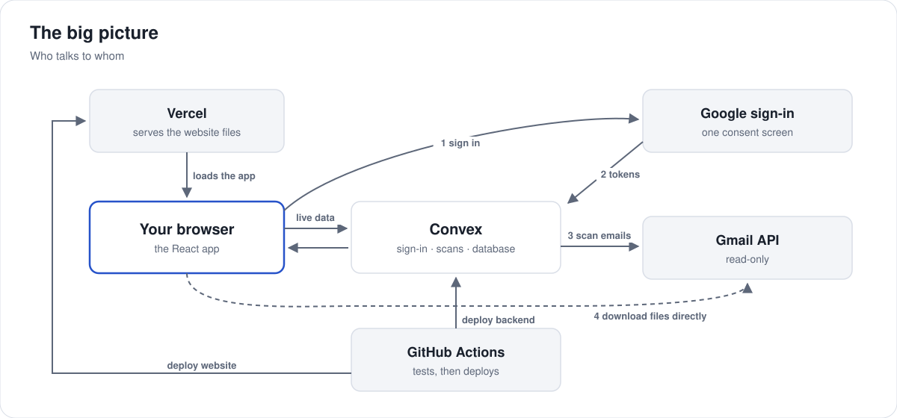
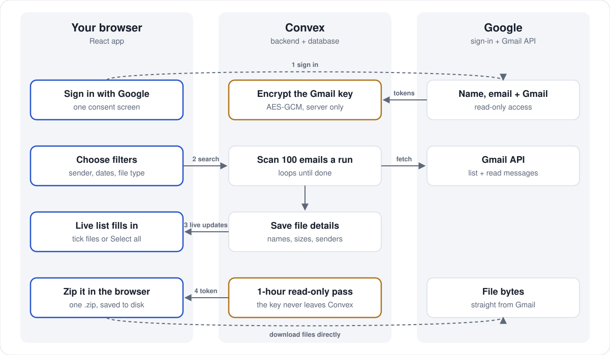
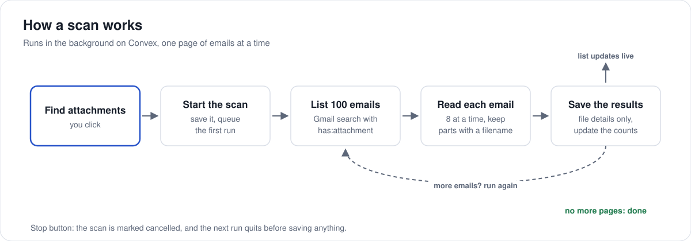
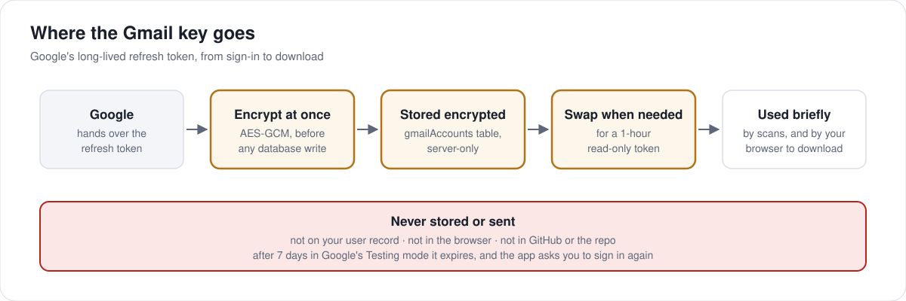

<p align="center">
  
</p>

<p align="center">
  
</p>

<p align="center">
  
</p>

<p align="center">
  
</p>

<p align="center">
  
</p>

<p align="center">
  
</p>

<p align="center">
  
</p>

<p align="center">
  <a href="https://gmail-attachments.vercel.app"><b>Production</b></a> ·
  <a href="https://gmail-attachments-staging.vercel.app"><b>Staging</b></a>
</p>

<details>
<summary><b>Run it locally</b></summary>

1. Google Cloud: enable the **Gmail API**, set the OAuth consent screen to **Testing**, add test users, and create a **Web** OAuth client.
2. Start the backend and set its keys:
   ```sh
   bun install
   bunx convex dev
   bun scripts/setup.ts --google-id <CLIENT_ID> --google-secret <CLIENT_SECRET>
   ```
   Add the origin and redirect URI the script prints to the Google client.
3. Run the app with `bun run dev`, then open http://localhost:3000.

Checks: `bun run typecheck` · `bun test` · `bun run build`
</details>

<details>
<summary><b>Environments and deploys</b></summary>

| Environment | Website | Convex deployment |
|---|---|---|
| dev | http://localhost:3000 | your `dev/…` deployment |
| staging | https://gmail-attachments-staging.vercel.app | `staging` (glorious-leopard-388) |
| production | https://gmail-attachments.vercel.app | default prod (flippant-jay-368) |

- **Pull requests:** checks only.
- **Pushes to `main`:** checks, then staging, then production after you approve it under **Review deployments** on the run.
- **Each GitHub environment holds:**
  - secrets: `CONVEX_DEPLOY_KEY`, `VERCEL_TOKEN`
  - variables: `CONVEX_URL`, `SITE_URL`, `VERCEL_ORG_ID`, `VERCEL_PROJECT_ID`
- **To set up a new environment:** run `bun scripts/setup.ts --deployment <name> --copy-google-from dev --site-url <url>`.
- **Google's Testing mode:** the Gmail permission expires every 7 days, and the app asks you to sign in again when it does.
</details>
